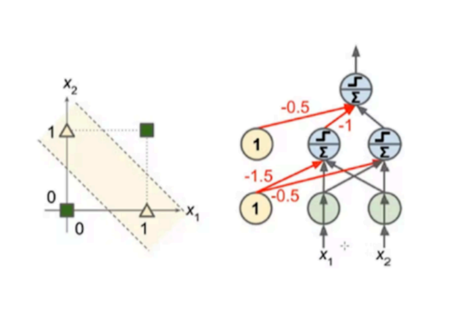

# Deep Learning — XOR, MLP, CNN (from scratch)

Trois TP implémentant la rétropropagation à la main : XOR, MLP, puis CNN.

## Contexte
TPs Deep Learning & Traitement d images, Master 2 (ESP/UCAD). Encadrant : Dr M. Kaba Keita.

## Contenu
- `docs/` : rapports 1 (XOR), 2 (MLP), 3 (CNN) + sources LaTeX.

## Co-auteurs
Ibrahima Fall, Souaibou Dieng.

## Licence
Contenu rédactionnel — tous droits réservés.

## Captures
Voir le dossier `images/`.

